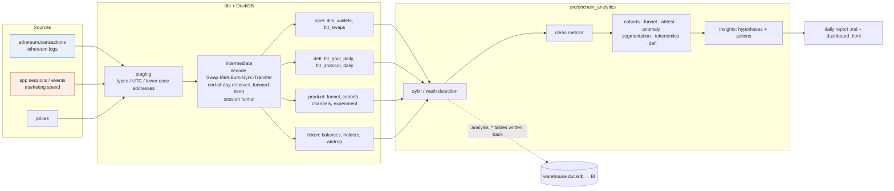

# On-chain Analytics: DEX Growth & Protocol Health

An end-to-end Web3 analytics project. It starts from **raw blockchain logs**, decodes and models them with dbt, joins them with **off-chain product analytics**, and produces DeFi metrics, user growth and retention, A/B test results, sybil and wash-trading detection, and tokenomics analysis. It then auto-generates a **daily report and an interactive dashboard** with actionable recommendations.

It ships with a Claude Code skill ([`.claude/skills/onchain-analyst/`](.claude/skills/onchain-analyst/SKILL.md)) that applies the same method to **real** on-chain data (Dune / DefiLlama / Etherscan / RPC).

```
python pipeline.py      # ~30s: generate data → dbt build (26 models + 25 data tests) → analysis → report
```

Outputs: [`reports/output/latest_report.md`](reports/output/latest_report.md) (daily report) · [`reports/output/dashboard.html`](reports/output/dashboard.html) (dashboard; open it in a browser)

---

## Why simulated data, and how to switch to real data

> **DemoSwap is a fictional protocol.** All data in the pipeline below is generated by the simulator. See the [real-data case study](#real-data-case-study-base-dex) for work on live chain data.

The simulator (`data_gen/generate.py`) follows **Uniswap V2's actual contract mechanics** (constant-product AMM, 0.3% fee, arbitrage bots) to generate five months of activity for a fictional DEX called "DemoSwap". Its tables mirror Dune's raw schemas:

| Table | Dune equivalent | Contents |
|---|---|---|
| `raw_transactions` | `ethereum.transactions` | ~77k transactions (including failed ones) |
| `raw_logs` | `ethereum.logs` | ~155k event logs; `topic0..3` and `data` are raw hex and **must be decoded** |
| `raw_prices_daily` | `prices.day` | daily token prices |
| `raw_app_sessions / events` | Segment / Amplitude tracking | ~247k sessions, ~632k events: visit → connect wallet → quote → submit (with `tx_hash`) |
| `raw_marketing_spend` | ad platforms | daily spend per channel |

Two reasons for this design:
1. **Reproducible offline and in CI**: anyone can clone the repo and run it.
2. **Ground truth to validate the methods**: the simulator plants sybil clusters, wash trading, a market-maker exit, a team token unlock and an A/B effect. The analysis layer finds them **without looking at the labels**, then gets scored against the truth (see *Model validation* below). Real chain data has no labels, so this step shows the detection methods themselves work.

**Switching to real data:** `dune_queries/` contains 9 DuneSQL queries that run directly on Dune against real protocols (Uniswap etc.). Alternatively, use `onchain_fetch.py rpc logs` to pull Swap/Sync/Mint/Burn logs for any V2 pool, land them as parquet in the same schema, and run `python pipeline.py --skip-generate`.

---

## Capabilities → where to find them

| Capability | Where it lives |
|---|---|
| On-chain + off-chain data: transactions, wallets, tokens, contracts, user behaviour | Decodes Swap/Mint/Burn/Sync/Transfer from raw `ethereum.logs`; joins front-end events to on-chain receipts via `tx_hash` (`int_session_funnel`) |
| Dashboards and reports that monitor core metrics | `reports/output/dashboard.html`: KPIs, TVL, volume composition, reported vs clean DAU, cohort heatmap, funnel, experiment, anomalies |
| User behaviour, retention, churn, funnels, acquisition | `fct_cohort_retention_weekly`, `cohorts.monthly_churn`, `fct_funnel_daily`, `fct_channel_performance` (CAC / D30 / LTV) |
| DeFi metrics: TVL, volume, liquidity, fees, yield | TVL from Sync reserves × price; fee APR, volume/TVL (capital efficiency), **LP returns vs impermanent loss**, break-even volume, LP concentration |
| Segmentation, cohorts, anomaly detection, opportunities | Value tiers / behavioural segments / RFM; robust z-score anomaly detection with **automatic attribution** (which wallets, which pool); sybil and wash-trading detection |
| SQL on large datasets | dbt + DuckDB (dialect close to Trino); `dune_queries/` holds the DuneSQL production versions |
| Automated reporting and pipeline improvement | `pipeline.py` runs everything in one command; GitHub Actions runs it daily, runs the tests and publishes the report (`.github/workflows/onchain_daily_report.yml`) |
| Hypotheses and actionable recommendations | Every finding is written as evidence → hypothesis → recommendation → expected impact → priority (`report.build_insights`) |
| Python: pandas, NumPy | `src/onchain_analytics/*` |
| BI tools | Custom HTML dashboard; `data/warehouse.duckdb` plugs into Metabase / Superset (DuckDB driver), and the `analysis_*` tables use the same definitions as the report |
| Statistics, A/B testing, cohort analysis | User-level two-proportion z-test with CIs, **SRM check**, MDE / sample-size calculation; explains why session-level analysis is wrong |
| Transaction structure, addresses, event logs, contract calls | `tx.from` vs the event's `sender` (router / bot contract), indexed topics vs data, decimals, failed txs have no logs, token0 ordered by address… see the skill's `references/evm_data_model.md` |
| Dune / DuneSQL / Trino | `dune_queries/01-09`: daily KPIs, new vs returning, cohorts, raw-log decoding reconciled against `dex.trades`, tiers, wash screen, funding clusters, airdrop sell-through, holder concentration |
| DeFi / DEX / tokenomics / liquidity mechanics | AMM simulation, arbitrage, impermanent loss, airdrop outcome (sybil vs genuine sell-through), unlock detection, Gini / Nakamoto coefficient |
| Block explorer APIs, indexed data | `onchain_fetch.py`: Etherscan V2, JSON-RPC `eth_getLogs` (adaptive block-range splitting), Dune API, DefiLlama |
| dbt and data pipelines | staging → intermediate → marts; schema tests plus 6 custom data tests (supply conservation, TVL vs flow reconciliation, funnel monotonicity, amount sanity, …) |

---

## Architecture



Key modelling decisions:
- **Trader = `tx.from`**, not the Swap event's `sender` (that's the router or a bot contract).
- **USD value comes from the most trustworthy leg**: stablecoin > WETH > long-tail token (`pricing_priority`), so bad prices on illiquid tokens can't inflate volume.
- **TVL comes from Sync events**: each pool's reserves at its last Sync of the day, forward-filled on days without activity. A test checks that TVL change ≈ price change + net flows.
- **"Users" are defined in two layers**: dbt removes labelled bots, protocol addresses and non-router callers; Python then removes sybils and wash traders via funding clusters. Every core metric is reported as both *reported* and *clean*.

---

## Findings (current run, simulated data)

| Priority | Finding | Recommendation |
|---|---|---|
| P0 | The new swap UI lifts quote→submit conversion from 51.3% to 56.5% (p≈3e-11, SRM healthy) | Ship to 100%; ~2,000 extra swaps per month |
| P0 | Sybils (8 funding clusters, 799 wallets) took 25% of the airdrop and sold 99.9% within 24h; genuine users sold only 32% within 7 days | Filter funding clusters before airdrops; weight points by fees and holding time; vest linearly |
| P1 | Every paid channel has 30-day LTV/CAC < 0.15; quest-platform D30 retention is 50% vs 86% organic | Shift budget to KOL referrals paid on retention; redesign quests around retention |
| P1 | WETH-USDC LPs underperformed holding: fees +1.17%, impermanent loss −3.52% | Consider concentrated liquidity / dynamic fees; subsidise real volume instead of TVL |
| P1 | On 9/12 a single market maker exited and TVL fell 30% in one day (that address supplied 53% of all deposits) | Monitor single-LP share; agree lock-ups with market makers |
| P2 | $4.5M of early-September volume was wash trading by 2 wallets with one funder; reported DAU on 8/1 was 1,260 vs 461 clean | Use clean metrics for internal and external KPIs |

Full details in the [daily report](reports/output/latest_report.md).

### Model validation (against the simulator's hidden ground truth)

| Check | Result |
|---|---|
| Sybil wallets | precision 100% · recall 99.0% (the 8 missed never completed a swap) |
| Wash-trading wallets | precision 100% · recall 100% |
| Market-maker exit / airdrop dump / team unlock | ✓ all detected |
| Wash-trading days (3) | 2 of 3 detected |
| A/B true lift +6.0pp | estimated +5.7pp, 95% CI [4.6, 6.8] ✓ covers the truth |

These are asserted automatically in CI by `tests/test_pipeline_ground_truth.py`.

---

## Real-data case study: Base DEX

A case study on live data: **user retention, trader tiers and bot share for a DEX on Base over the last 90 days**, using Dune's `dex.trades`.

- Queries: [`dune_queries/base_case/`](dune_queries/base_case/) (discovery, daily KPIs, new vs returning, weekly cohort retention, trader tiers, bot / wash screen)
- Runner: [`scripts/run_dune_case.py`](scripts/run_dune_case.py), triggered by the **"dune base case study"** GitHub Actions workflow
- Results are committed to `data/real/base_case/`

To run it, add a Dune API key as the repository secret `DUNE_API_KEY` (Settings → Secrets and variables → Actions), then trigger the workflow from the Actions tab. *Status: queries and runner are ready; results are pending a Dune API key.*

---

## Repository layout

```
.
├── pipeline.py                 one-command run
├── data_gen/generate.py        AMM simulator: raw on-chain logs + off-chain events + ground truth
├── dbt/                        staging / intermediate / marts + tests + EVM decoding macros
│   └── macros/evm_decoding.sql   hex_word_to_uint / topic_to_address (with DuneSQL equivalents)
├── src/onchain_analytics/      cohorts · funnel · abtest · anomaly · sybil · segmentation · tokenomics · defi · report
├── reports/                    build_report.py + dashboard template; output/ holds the current run
├── dune_queries/               9 production DuneSQL queries for real protocols, plus base_case/
├── scripts/run_dune_case.py    runs the Base case study on the Dune API
├── tests/                      unit tests + ground-truth integration tests
├── .claude/skills/onchain-analyst/   Claude Code skill for researching real on-chain data
└── .github/workflows/          daily pipeline + tests + report; Dune case-study runner
```

## Quick start

```bash
pip install -r requirements.txt
python pipeline.py              # or: make all
python -m pytest -q tests       # 20 tests
make docs                       # dbt lineage graph at http://localhost:8080
```

## The companion skill: researching real on-chain data

`.claude/skills/onchain-analyst/` is a Claude Code skill. Open Claude Code in this repo and ask something like "analyse Aerodrome's user retention over the last 90 days" or "how much of this airdrop went to sybils?" and it triggers. It follows a six-step workflow: frame the question → identify contracts and events → choose the data source → write the query → **validate** → analyse and recommend.

```bash
S=.claude/skills/onchain-analyst/scripts
python $S/evm_tools.py topic0 "Swap(address,uint256,uint256,uint256,uint256,address)"
python $S/onchain_fetch.py llama tvl --protocol uniswap --out uni_tvl.csv
DUNE_API_KEY=... python $S/onchain_fetch.py dune sql --file dune_queries/03_weekly_cohort_retention.sql --param project=uniswap --param blockchain=ethereum --param days=180
```

> Note: `onchain_fetch.py` follows each API's public documentation, but the build environment had no internet access, so it **has not yet been verified against the live APIs**. Run a small query first. `evm_tools.py` (a pure-Python keccak256) is tested against known topic hashes.
